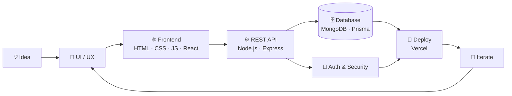

<!-- ============================================================
  HOW TO USE
  1. Open your repo  sujithkiran02/sujithkiran02  ->  README.md  ->  Edit
  2. Replace everything with this file, then Commit
  3. Search for "YOUR_" and "EDIT:" below and fill in your details
============================================================ -->

<div align="center">


<a href="https://github.com/sujithkiran02">
  
</a>

<br/>


<p>
  <a href="#-featured-projects">Projects</a> •
  <a href="#-tech-stack">Tech Stack</a> •
  <a href="#-how-i-build">How I Build</a> •
  <a href="#-github-stats">Stats</a> •
  <a href="#-lets-connect">Contact</a>
</p>

</div>

---

## 👨‍💻 About Me

I'm a **full stack developer** who enjoys taking an idea from a blank editor to a **live, deployed product**: designing the UI, building the API, modelling the data and shipping it on the cloud. I also love solving problems on LeetCode and building security-focused projects at hackathons.

```js
const sujith = {
  name: "Sujith Kiran",
  role: "Full Stack Developer",
  location: "Tamil Nadu, India 🇮🇳",              
  frontend: ["HTML", "CSS", "JavaScript", "TypeScript", "React"],
  backend: ["Node.js", "Express", "REST APIs", "Serverless"],
  database: ["MongoDB", "Prisma", "SQL"],
  extras: ["Blockchain", "Solidity", "Post-Quantum Crypto"],
  currentlyLearning: ["System Design", "Advanced DSA", "Cloud & DevOps"],
  funFact: "I turn hackathon ideas into deployed products 🚀",
  openTo: ["Internships", "Freelance", "Open-source collabs"],
};
```

---

## 🛠️ Tech Stack

### 🎨 Frontend


### ⚙️ Backend & APIs


### 🗄️ Databases & ORM


### ⛓️ Web3 & Security


### ☁️ Deployment & Tools


> 💡 *Delete any badge above that you don't actually use. A short, honest stack looks better than a long one.*

---

## 🧭 How I Build

Every project I ship follows the same end-to-end flow:



| Layer | What I do |
|:--|:--|
| **🎨 Frontend** | Responsive, clean interfaces with vanilla JS and component-based UIs |
| **⚙️ Backend** | REST APIs, serverless functions, validation and error handling |
| **🗄️ Data** | Schema design, queries and persistence with MongoDB and Prisma |
| **🔐 Security** | Authentication, role-based access, tamper detection, replay-attack prevention |
| **🚀 Delivery** | Git workflow, `.env` config, one-click deployments on Vercel |

---

## 🚀 Featured Projects

### ⭐ Main Repository

<table>
  <tr>
    <td valign="top">
      <h3>🧩 LeetCode: Problem Solving Journey</h3>
      <p>My data structures & algorithms practice repo: arrays, strings, hashing, two pointers, recursion, trees, graphs and dynamic programming. Strong fundamentals behind every full stack app I build.</p>
      <p>
        
        
      </p>
      <a href="https://github.com/sujithkiran02/LeetCode">📂 View Repository</a>
    </td>
  </tr>
</table>

### 🌐 Full Stack Projects

<table>
  <tr>
    <td width="50%" valign="top">
      <h3>🏙️ Civic Connect</h3>
      <!-- EDIT: replace this line with what your project really does -->
      <p>Civic engagement web application. <b>EDIT: add 1–2 lines about what problem it solves, who uses it and your role.</b></p>
      <p>
        
        
      </p>
      <a href="https://github.com/sujithkiran02/civic_connect">📂 Source Code</a>
    </td>
    <td width="50%" valign="top">
      <h3>🎯 SkillMatchPro</h3>
      <p><b>AI-powered resume intelligence platform.</b> Analyzes resumes, maps skills to job roles and recommends career learning resources. Serverless API with a MongoDB backend, deployed on Vercel.</p>
      <p>
        
        
        
        
      </p>
      <a href="https://github.com/sujithkiran02/SkillmatchPro">📂 Source Code</a> •
      <a href="https://skillmatch-pro-three.vercel.app/">🌐 Live Demo</a>
    </td>
  </tr>
  <tr>
    <td width="50%" valign="top">
      <h3>🌐 Multi-Page Web App (project.1)</h3>
      <p>Responsive multi-page website with <b>About, Features, Generator and Help</b> pages, built with vanilla HTML, CSS and JavaScript and deployed live.</p>
      <p>
        
        
        
      </p>
      <a href="https://github.com/sujithkiran02/project.1">📂 Source Code</a> •
      <a href="https://project-1-phi-sandy.vercel.app">🌐 Live Demo</a>
    </td>
    <td width="50%" valign="top">
      <h3>💼 Nodal</h3>
      <p>Modern <b>SaaS landing page</b> project focused on clean layout, typography and conversion-friendly design.</p>
      <p>
        
        
      </p>
      <a href="https://github.com/sujithkiran02/Nodal">📂 Source Code</a>
    </td>
  </tr>
  <tr>
    <td colspan="2" valign="top">
      <h3>🤖 Nexora AI</h3>
      <p>AI application with a clear <b>client / server architecture</b>: a separate frontend and backend, deployed live on Vercel.</p>
      <p>
        
        
        
      </p>
      <a href="https://github.com/sujithkiran02/nexora_ai">📂 Source Code</a> •
      <a href="https://nexora-ai-rho-five.vercel.app/">🌐 Live Demo</a>
    </td>
  </tr>
</table>

### 🛡️ Hackathon Flagship

<table>
  <tr>
    <td valign="top">
      <h3>🔐 BEL SecureChain: Defense-Grade Identity & Zero-Trust Platform</h3>
      <p><b>Smart India Hackathon (SIH), Problem Statement 26125</b> for Bharat Electronics Limited. A full stack security platform featuring:</p>
      <ul>
        <li>🪪 <b>Self-Sovereign Identity</b> with W3C DIDs and Verifiable Credentials</li>
        <li>⚛️ <b>Post-quantum cryptography</b> (NIST FIPS 204, ML-DSA-65) with dual ECDSA + PQC proofs</li>
        <li>🛑 <b>Zero-Trust policy engine</b> combining RBAC, clearance levels, facility access and biometric attestation</li>
        <li>🗃️ <b>Anti-tamper asset vault</b> with SHA-256 verification and ERC-721 ownership</li>
        <li>📜 <b>Blockchain audit log</b> and a SOC threat radar</li>
        <li>✅ <b>19 automated security tests</b> covering 6 attack scenarios (replay, privilege escalation, IDOR, tampering, revoked credentials)</li>
      </ul>
      <p>
        
        
        
        
        
      </p>
      <a href="https://github.com/sujithkiran02/BEL-SecureChain-SIH">📂 Source Code</a>
    </td>
  </tr>
</table>

---

## 📊 GitHub Stats

<div align="center">


<br/>


<br/><br/>


</div>


## 🎯 Currently Focused On

| 🔹 Area | 📌 Goal |
|:--|:--|
| **Full Stack Development** | Ship production-grade apps end to end: UI, API, database and deployment |
| **Security & Blockchain** | Zero-trust systems, verifiable credentials, post-quantum crypto |
| **Data Structures & Algorithms** | Consistent LeetCode practice for strong fundamentals |
| **Open Source** | Start contributing to projects I use every day |

---

## 🤝 Let's Connect

<div align="center">

<a href="https://www.linkedin.com/in/YOUR_LINKEDIN_USERNAME/">
  
</a>
<a href="mailto:YOUR_EMAIL@gmail.com">
  
</a>
<a href="https://leetcode.com/YOUR_LEETCODE_USERNAME/">
  
</a>
<a href="https://instagram.com/YOUR_INSTAGRAM_USERNAME">
  
</a>
<a href="https://YOUR_PORTFOLIO_URL">
  
</a>

<br/><br/>

📫 **Open to internships, freelance work and collaborations. Let's build something great together!**

</div>

---

<div align="center">

### 💡 "First, solve the problem. Then, write the code."


⭐ *If you like my work, drop a star on a repo. It keeps me motivated!*

</div>
